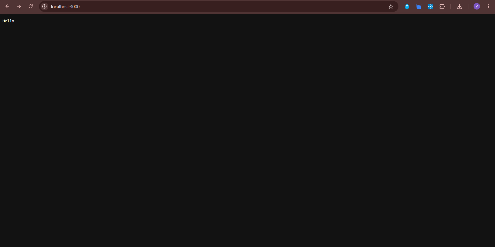
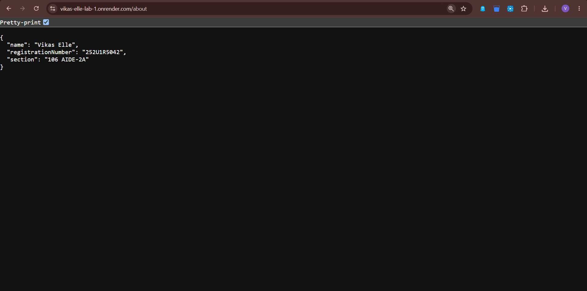
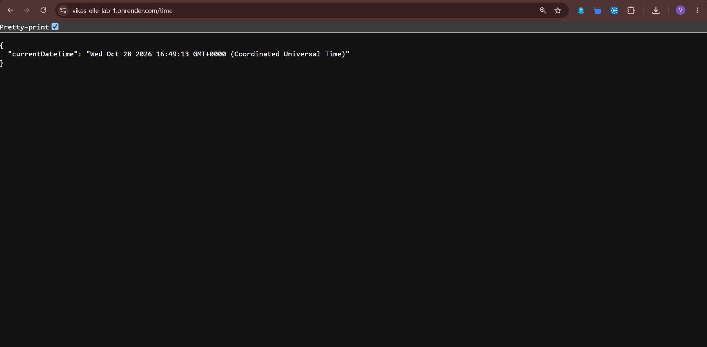
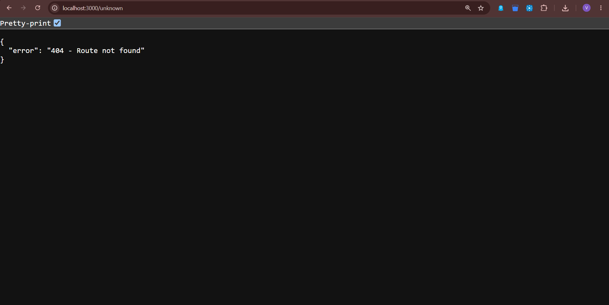

# Lab 1: Node.js and Express Server

**Deployment URL:** https://vikas-elle-lab-1.onrender.com/

<<<<<<< HEAD
## Student Details

- **Name:** Vikas Elle
- **Registration Number:** 252U1R5042
- **Section:** 106 AIDE-2A
=======
## 1. Student Details

* **Name:** Vikas Elle
* **Registration Number:** 252U1R5042
* **Section:** 106 AIDE-2A
* **Subject:** Backend Development Fundamentals
* **Lab:** Lab 1 — Node.js and Express Server

## 2. Objective

The objective of this lab is to understand the fundamentals of Node.js and Express.js by creating a basic HTTP server, implementing API endpoints, handling HTTP requests and responses, and managing unknown routes using an appropriate status code.

## 3. Technologies Used

* Node.js
* Express.js
* JavaScript
* npm (Node Package Manager)
* Visual Studio Code
* Git and GitHub
* Render (Deployment)

## 4. Project Structure

```text
Vikas-Elle/
├── basic-server.js
├── server.js
├── package.json
├── package-lock.json
├── README.md
├── .gitignore
└── screenshots/
    ├── home.png
    ├── about.png
    ├── time.png
    └── unknown.png
```

## 5. Installation Instructions

Follow these steps to run the project locally.

### Prerequisites

Ensure that Node.js and npm are installed on your system.

Check the installed versions:

```bash
node -v
npm -v
```

### Step 1: Clone the Repository

```bash
git clone https://github.com/vikas01-design/Vikas-Elle.git
```

### Step 2: Navigate to the Project Directory

```bash
cd Vikas-Elle
```

### Step 3: Install Dependencies

```bash
npm install
```

This command installs the dependencies specified in `package.json`, including Express.js.

## 6. Execution Instructions

### A. Run the Basic Node.js HTTP Server

Execute:

```bash
node basic-server.js
```

The server starts on port 3000.

Open the following URL in your browser:

```text
http://localhost:3000
```

Expected output:

```text
Hello
```

### B. Run the Express Server

Execute:

```bash
npm start
```

Expected terminal output:

```text
Express server running on port 3000
```

The application is now ready to receive HTTP requests.

Keep the terminal running while testing the endpoints.

## 7. API Endpoints

The application provides three main GET endpoints and a 404 handler for unknown routes.

### Endpoint 1: Home

* **Method:** GET
* **Path:** `/`
* **Purpose:** Displays a welcome message.
* **Status Code:** 200 OK

Example URL:

```text
http://localhost:3000/
```

Expected response:

```text
Welcome to my Node.js and Express Server!
```

### Endpoint 2: About

* **Method:** GET
* **Path:** `/about`
* **Purpose:** Returns student information in JSON format.
* **Status Code:** 200 OK

Example URL:

```text
http://localhost:3000/about
```

Example response:

```json
{
  "name": "Vikas Elle",
  "section": "YOUR_SECTION"
}
```

Replace `YOUR_SECTION` with your actual section.

### Endpoint 3: Time

* **Method:** GET
* **Path:** `/time`
* **Purpose:** Returns the current date and time.
* **Status Code:** 200 OK

Example URL:

```text
http://localhost:3000/time
```

Example response:

```json
{
  "currentDateTime": "Current date and time generated by the server"
}
```

The actual response contains the date and time generated by `new Date()`.

### Endpoint 4: Unknown Route

* **Method:** GET
* **Path:** `/unknown`
* **Purpose:** Returns an error response for an undefined route.
* **Status Code:** 404 Not Found

Example URL:

```text
http://localhost:3000/unknown
```

Expected response:

```json
{
  "error": "404 - Route not found"
}
```

### API Summary

| HTTP Method | Endpoint   | Description                       | Status Code   |
| ----------- | ---------- | --------------------------------- | ------------- |
| GET         | `/`        | Displays a welcome message        | 200 OK        |
| GET         | `/about`   | Returns student information       | 200 OK        |
| GET         | `/time`    | Returns the current date and time | 200 OK        |
| GET         | `/unknown` | Handles an undefined route        | 404 Not Found |

**Note:** The URLs above use the local development server. After deployment, replace `http://localhost:3000` with the public deployment URL.

## 8. Screenshots

The following screenshots demonstrate the output of the application's endpoints.

### 8.1 Home Endpoint

This screenshot demonstrates the welcome message returned by the home endpoint.



### 8.2 About Endpoint

This screenshot demonstrates the student information returned in JSON format.



### 8.3 Time Endpoint

This screenshot demonstrates the current date and time returned by the server.



### 8.4 Unknown Route

This screenshot demonstrates the 404 response returned for an undefined route.



## 9. Notes

* Node.js provides the runtime environment for executing JavaScript on the server.
* The built-in `http` module is used to create the basic server.
* Express.js simplifies server creation and route handling.
* The `app.get()` method defines GET endpoints.
* The request object (`req`) represents the incoming HTTP request.
* The response object (`res`) is used to send data and status codes to the client.
* The `app.listen()` method starts the server on the specified port.
* HTTP status code `200` indicates a successful request.
* HTTP status code `404` indicates that the requested route was not found.
* The `node_modules` directory is excluded from version control using `.gitignore`.

## 10. Conclusion

This lab provided practical experience in developing web servers using Node.js and Express.js. I learned how to initialize a Node.js project, manage dependencies using npm, create a basic HTTP server, and implement GET endpoints using Express.

I also learned how to return JSON responses, generate the current date and time, handle unknown routes using HTTP status code 404, and test the application's endpoints. Finally, I used GitHub for version control and deployed the application to make it accessible through a public URL.

Overall, this lab strengthened my understanding of backend development fundamentals and the basic structure of a web server.

## 11. GitHub Repository

**Repository:** https://github.com/vikas01-design/Vikas-Elle

**Deployment:** https://vikas-elle-lab-1.onrender.com/
>>>>>>> 21c2ee144bd2da8f09cf0b1aeb3b091bcbc397d0
